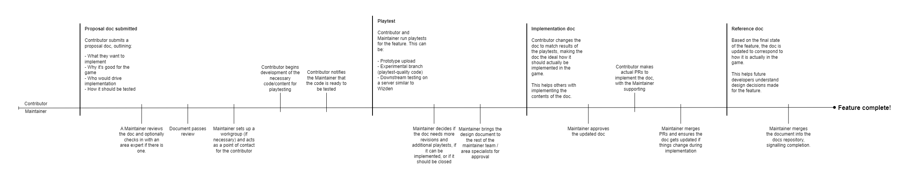

# Feature Proposals

If you are considering adding or reworking some major component of the game it's recommended that you submit a proposal before you actually start coding whatever it is you want to do. Pinning down exactly how your feature should work to mesh well with the rest of the game will save you a lot of headaches rewriting your PR for the ~~1st2nd4th~~ 7th time before it gets merged. It also gives you a pathway to playtesting your changes in an early stage, giving you a better understanding of how your feature will work in the game.

## How do I make a proposal?

1. Make a copy of the design proposal template located at `src/en/templates/proposal.md`.
   
3. Read through [SS14's Core Design Documentation](../space-station-14/core-design.md) (for gameplay-related proposals).

4. Write your proposal (see [guide to editing docs](../meta/guide-to-editing-docs.md)).

5. When you are ready for your proposal to be reviewed, make a pull request.

6. Your proposal is approved when a maintainer gives it the `Proposal Doc Approval` label. This is a green light for you and your collaborators to work with the approving maintainer to implement it as a playtest (described below).

7. If the playtest goes well, the maintainer will give feedback on any changes you need to make. At this point, you update your proposal with implementation details to help give an understanding of how the feature will be added. If the maintainer gives the `Implementation Doc Approval` label, you're off to making proper PRs!

8. As you get your feature's code merged into the game, you update your document based on any design changes that happen during implementation. 

10. Once the feature is fully implemented, the maintainer gives a final approval and merges your design doc into the repository, along with a link in the side bar. Feature complete! *Note to maintainers: edit `src/SUMMARY.md`*

``` admonish tip "Unfinished Proposals"
If you don't think that your proposal is ready for maintainer scrutiny, but still want feedback on it you can PR it as a draft. Drafts are less likely to attract people looking to get down to brass tacks, but still let people comment and give advice.
```

## No, as in what is a design doc?

A design document is a high level summary of whatever you're proposing to add to the game. They basically serve to get nebulous ideas down on paper so it's easier to see how exactly those ideas will mesh with the rest of the project. They generally have a few parts.

When submitting a design, we ask that you start with a proposal document. Ideas always change during development as players test your feature and developers implement it, so in a proposal document we are looking for the following:

1. Why the feature is good to have in the game. This is the most important part! Are you adding something new or fixing an existing problem? Something being "cool" is a good starting point, but you need to show that you've considered how your feature works alongside other features and content. Describe why your feature is something that will benefit the game long-term, how it fits with the game's design pillars, and how it will work with the game overall.
2. A high-level summary of what the feature actually is. What are the players expected to do with your feature, what is its goals for the game and the players, what are the mechanics and aesthetics? You want to cover what the player will be doing, and also what the player should be feeling when interacting with your feature.
3. Who will be implementing the feature. We find that the best features have someone who can help push the actual implementation through. If you yourself don't have the programming skills required, talk about your ideas with the community! Get people excited! Space Station 14 is also a great opportunity to [learn some basic coding](../general-development/setup/howdoicode.md), and you can implement a lot with very simple code. 
4. How your feature should be tested. A key step in the design doc process is to get a quick-and-dirty version of your feature into the hands of players. That's a great way to find out if your feature has any hidden flaws that need to be worked on. Briefly describe how your feature should be playtested, based on the criteria below.

``` admonish warning "Don't"
- Include pseudocode level descriptions of how your feature works. That's for after the proposal has been accepted and you're actually implementing the thing.
- Specify numerical amounts for every item, field, or mechanic. That's for eventual balance bikeshedding; for example it's enough to say that a disease will have one, several, or many symptoms.
- Forget to include how players should interact with your features. SS14 is a multiplayer game and how the players engage with your mechanics is more important than the specific mechanics they engage with.
- Write an entire, actual FSD or SRS. It's not and will never be required as it constitutes egregious overkill for a project of our size and structure.
```

``` admonish tip "Design Principles"
If you want to improve your chances, it's recommended that you read the [SS14 Core Design Documentation](/src/en/space-station-14/core-design.md) document to get a high-level overview before you start writing, as it'll provide context for why things are the way they are.
```

## Does my idea really need a design doc?

It depends on the scale, and pervasiveness of whatever you're thinking of proposing. If it's something like adding a single gun or a couple simple plants it probably won't. On the other hand if you are adding an entire subdepartment ala anomalies/xenoarchaeology, or something on the order of reworking the entirety of botany or chemistry it certainly will.

A good rule of thumb if the new feature or rework you have in mind would require adding or reworking a page of the guidebook or one of the feature docs on this site then it probably needs a design doc. Same if the proposal could be accurately described as 'reworking the entirety of X'.

## What happens after I submit the proposal doc?

A maintainer will have to review your document and determine if it is an idea worth testing. If there is an area specialist, such as a workgroup, the maintainer is expected to reach out to them for expert opinion. Not everything passes this bar! Sometimes an idea is not developed enough, or has overlap with an existing feature. Don't be discouraged if it happens, an idea can be good but simply not be the right fit for this game. 

If the maintainer approves the proposal, they will assign the `Proposal Doc Approval` label. You are then free to start working on the playtest implementation of your feature. If necessary, the maintainer can help set up a workgroup space for you on our Discord server so you can bring in any fellow developers and stay up to date with communications. 

## How do I playtest?

We ask that any feature proposal doc goes through a playtest. This can be done in three different ways:

### Prototype Upload

Space Station 14 has a very efficient way to run the game, which is through [entity prototypes](https://docs.spacestation14.com/en/ss14-by-example/adding-a-simple-bikehorn.html). Every item, NPC, and puddle on the floor is an entity that has a bunch of building blocks (components) that define how they work. These components define things like the entity's sprite, if it can be picked up, if it can be swung like a weapon, what damage it would deal, all in very simple `.yml` files. And because our core developers are really cool, we can upload those files directly to our live servers!

Prototype upload playtesting is best for features that are similar to existing features. This is because you are limited to the components that already exist, so you can't include completely new game code. Luckily we have a lot of components, so for many features it can get you 95% of the way there and be enough to playtest your idea. The benefit is that it's very easy to host a prototype upload playtest, making it by far the fastest option. 

Once you have your prototype files ready, contact the reviewing maintainer to host a playtest. You will work together with an admin to upload the files to one of our game servers. Make sure your proposal includes any instructions that players/admins need to know!

### Experimental Branch

If your feature requires actual code changes, the maintainer can set up an experimental branch for you on the `space-station-14` Github repository. You can then develop your playtest on your own repository and, when ready, submit it to the experimental branch. The maintainer can then create a game build and push it to one of our live game servers to test for a day.

Playtesting with an experimental branch comes with some downsides. Unlike a Prototype Upload, it's more of a commitment for the game admins to run your playtest since switching to and from it requires a server restart, and you need to submit any changes to the experimental branch as pull requests. The benefit is that you are not bound by existing prototype components and can test with actual code changes.

Your experimental branch does not need to, and should not have, the same code quality as we expect of real pull requests. Playtest code can be ugly code, as long as it works when testing! 

### Downstream Playtest

If your feature already exists on a downstream server, it might be eligible to be evaluated on that downstream instead of needing a separate playtest on the WizDen servers. The downstream server should not be too dissimilar to how the base game works, so make sure you verify with the reviewing maintainer that it's suitable for your feature. If it is, great! Arrange for the reviewing maintainer to observe your feature on the downstream for a few rounds, preferably in cooperation with the downstream's staff. 

Don't worry if you receive feedback that some changes will need to be made for upstream. Upstream may have different design requirements on features and their implementation, but seeing a feature work well in a downstream is a strong sign that the feature has potential for upstream as well.

## What happens after the playtest?

The maintainer will decide if the feature is viable to implement, if it needs further adjustments and playtests, or if it should be closed. If they approve, they will bring your design document to the maintainer team at large and ensure that the team as a whole approve of the design you've put forwards. This is either done through an internal forum post, or as a discussion during a maintainer meeting. If the rest of the maintainer body approves, the maintainer will assign the `Playtest Approval` label. At this point, you should update your proposal document into an **implementation document**.

An implementation document is an evolution of your proposal document, with an added section that describes actual feature implementations. This is to help other developers understand what needs to be implemented, how it should look like, and the purpose of what is being implemented. Do not include hard numbers or detailed descriptions of your features; the goal is to give an overview of what needs to be implemented for the feature to be considered complete, not an exact recipe for what has to be implemented. 

Once the maintainer approves of the implementation document by giving the `Implementation Doc Approval` label, you are off to the races! Create actual pull requests to the repository, get them reviewed and merged, and enjoy building your feature into the game! Make sure you follow the [pull request guidelines](https://docs.spacestation14.com/en/general-development/codebase-info/pull-request-guidelines.html) and [best practices](https://docs.spacestation14.com/en/general-development/codebase-info/conventions.html). 

## What happens after implementation?

As you are implementing your feature, you will likely find that you'll have to make some changes. That's the nature of game development. Make sure you update your design document accordingly during implementation. Once your feature is in the game and the design document accurately reflects the feature as it is in the game, your document should fulfill the purpose of being a **reference document**. This is a design document that:
- Describes why the feature is good for the game: design motivations, how its mechanics create the intended experience, how it interfaces with other parts of the game.
- What the feature is: the mechanics, the aesthetics, and the intended gameplay experience for players.
Your document should naturally evolve into this as you update it throughout implementation. It's key we have reference documents because they inform future developers why your feature is the way it is, and how new features can be developed without disrupting your feature.

Once your reference document is completed, notify the reviewing maintainer for a final approval; the maintainer will merge the design document into the docs repository under the relevant section, at which point your design document is considered fully complete! Congratulations!


