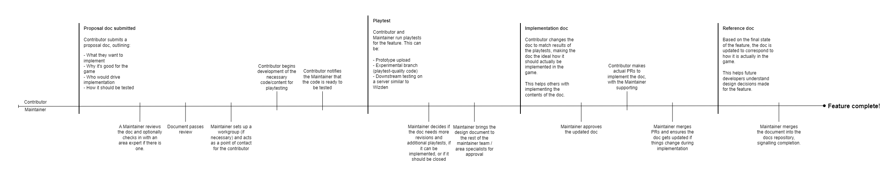

# Docs PR Review Procedure

### Pushing to the Docs Repo
Maintainers have direct push access to the Docs repo and are encouraged to use it to update any outdated information, whether it's technical documentation, amending a design document, or just fixing grammar.

### Non-Design Doc Reviews
PRs that update instructional or reference documentation (including, but not limited to, setup guides, style guides, and system documentation) require only a single approval before they can be merged.
Likewise, only a single maintainer needs to express concern to close it.

Note that this does not apply to changes to internal procedure or other modifications that require voting or group deliberation according to relevant policy.

## Design Docs Overview

This is the procedure maintainers should use when reviewing and approving design documents. 

Note that this procedure is primarily intended for *gameplay* design documents. Systems architecture, code convention and other features not interfacing with players do not need to follow the requirements for playtesting, and it is up to the reviewing maintainer to judge whether this procedure is suitable for any given document.

**When making updates to this page, ensure you update the [Feature Proposals](../../general-development/feature-proposals.md) page to match and vice versa.**

---

The design doc procedure consists of 4 main points: 

1. Proposal doc submission
2. Playtest
3. Implementation doc approval
4. Reference doc approval

The goal of this process is to have a low bar of entry to playtest new features and get an understanding of whether the proposed design is desirable, to not lock in designs before they are tested, and to ensure design documents aren't merged only to gather dust on the docs repository. 



### Proposal Doc Submission

Contributors should begin the process by writing a **proposal doc**. These should contain motivations for why the feature is good to have in the game, and what the feature is. When reviewing a proposal doc, don't make any assumptions that what's written in the doc is what will word-for-word end up in the game. It's meant to give an idea for what the contributor wants to bring to the game and, critically, playtest beforehand. Any feature that is large enough to require a design doc should be playtested to gather player sentiments and test out the feature's viability in the context of actual rounds. Additionally, the document must contain the name of at least one contributor who will be working on the feature, as well as the way the feature will be playtested.

If the proposal doc relates to an area where there is already a workgroup, or where there is a known area specialist, the reviewing maintainer should reach out and ask for their opinion on the document before giving approval. This is to avoid clashes where the workgroup has existing plans for content, and is just good practice to ensure expert opinions are provided.

A review of a proposal docs should generally be handled by only a few number of maintainers, with even just a single maintainer being sufficient. The maintainer(s) that takes it upon themselves to approve a document will also act as a contact point for the contributor going forward, to assist with playtests and doing further reviews as the document progresses.

Only approve a proposal that you yourself feel has potential; if a document doesn't spark any excitement or engagement, you may not make a good contact point to help push the feature through, and may point to the feature not being a good addition to the game.

If the proposal doc is approved, assign the `Proposal Doc Approval` label to the pull request. If necessary, it is recommended to create a workgroup space (e.g. a Discord thread in the `#contributors` channel) for the developers to work in. 

``` admonish tip "Approvals & Closing"
Proposal docs only need one approval to pass, or one disapproval to close, but ensure area specialists are consulted first if there are any. If you are critical of a proposal document that another maintainer is approving of, it's usually better to leave your feedback but let the work progress to the next stage.
```

``` admonish warning "Don't overexert yourself!"
Being the reviewing maintainer does *not* confer taking upon the responsibility to implement or design the feature. By all means help the contributor if you are engaged with the idea, but don't feel the need to actively work on it outside the scope as defined in this document.
```

### Playtest

A playtest is a necessary step to evaluate the actual viability of the feature. It's a way to get feedback on the idea, see how it works in practice, and for the contributor to adjust their design if necessary. Critically the playtest should require as little work as possible; make sure you inform the contributor(s) of this so that they don't spend time creating codebase-quality code or waste time polishing features that you may end up discarding.

The ways to playtest a proposal doc are listed on the [Feature Proposals](../../general-development/feature-proposals.md) page.

As the reviewing maintainer, make sure you stay in contact with the contributor(s) to help arrange the playtest they are doing. The playtest is an opportunity for you to review the feature, and your approval is a requirement for the document to continue to the next stage. 

The outcome of the playtest should be one of the following:
- The playtest was deemed unsuccessful, or the feature wasn't suitable for the game:
  - Inform the contributor, thank them for their time, and close the pull request.
- The playtest was inconclusive, or shows potential but needs more work:
  - Inform the contributor of the changes you would like to see, and ask for a revised proposal doc/playtest material.
- The playtest was successful, or sufficient enough to validate the feature for the game:
  - Give the doc pull request the `Playtest Approval` label.

If the document got approval, the next step is to confirm it with the rest of the maintainer team. This is to seek broader feedback with the strength of a successful playtest motivating the feature.

The reviewing maintainer has two options: 
- Bring up the design document on the next Maintainer meeting. This allows for active discussion during the call, and if consensus is reached during the meeting it is sufficient for team approval.
- Create an internal thread on the maintainer forum, with a `Yes`/`No`/`Abstain` poll to run for a minimum of 3 days. Majority opinion decides if the design document receives team approval.

#### How to run a playtest

Playtests require different amounts of admin involvement depending on the scope of the playtest. Generally, prototype upload playtests that last a few rounds can be done with the permission of a single admin, while experimental branches or longer-duration playtests over several days should get head admin approval. Maintainers are not allowed to start playtests themselves so make sure to coordinate with an admin; this is so that an admin is able to deal with any ahelps that may be generated from the playtest, or if the server crashes. Do not forget to involve the contributor making the feature! They should have access to the same information and control over the playtest as you do as a maintainer. 

Playtests may vary in how broadcasted they are. Admin policy is to inform players on a server that an event is being held at the start of a round. Optionally, a change to the server's Message Of The Day and a post in #admeme-announcements can be made. 

When running a playtest, avoid interfering with the players when possible. Unless there is something going catastrophically wrong, players should be allowed to experiment with the feature. Failing to understand a key aspect is itself useful information that indicates something with the feature needs to change.

Make sure to collect feedback! Ask players, in both OOC and directly in ahelps, especially those players who engaged directly with the feature. If you seek a wider consensus, you can run a poll at the end of the round; make sure to phrase it neutrally and don't put jokes in the options (a 1-5 scale tends to work well). 


``` admonish tip "Experimental branches"
Experimental branches can be created on the main repository Github, based on the master branch. When reviewing PRs for these branches, do not hold them to the same code quality standards as you would with regular PRs. Focus instead on the content and give deference to the contributor implementing the changes.

To run an experimental branch, access the "Actions" tab on Github and run the "Publish testing" workflow targeting the experimental branch. This will generate a content package and update any Nightly servers the next time a round ends. Note that while Nightly servers update to the latest master branch daily, admins are able to manually set which content package a server should run on via the `.revertserver` Discord command.
```

``` admonish tip "Downstream playtesting"
If a design document wishes to show its feature via downstream playtesting, take them up on the offer! Visit the server, observe the feature in action as a spectator, preferably with help from the server's admins so that you get a good understanding of how the feature works in the context of the playerbase and player sentiments towards it (maybe ask to playtest it yourself!). Make an evaluation for how it would work with upstream content. It is valid to reject a downstream playtest if you believe that the downstream codebase differs too heavily from upstream in regards to how it impacts the feature. 
```


### Implementation doc approval

Inform the contributor of the result and ask them to begin working on the **implementation doc**, as described on the [Feature Proposals](../../general-development/feature-proposals.md) page. The document should be enough of a blueprint such that a new developer could take the concept and implement it themselves. Once the document reaches this standard, assign it the `Implementation Doc Approval` label. This indicates that actual pull requests can be submitted to the main repository for merging.

### Reference doc approval

As the feature gets implemented, it is likely that the feature will receive some changes to make it work in the game proper. The design doc should be updated to reflect this. Once the feature is implemented fully, and the design document has been updated to accurately reflect the contents and motivations of the feature as it is in the game, the design document is considered a completed **reference doc**. The reference doc is used by future developers to understand why the feature was designed the way it was and how it is good for the game, allowing them to extend it further and/or add other features around it. 

Once the reference doc has approval, you ensure it is placed in the correct folder in the docs repo, can be accessed through the sidebar via `src/SUMMARY.md`, and then you may merge it into the docs repository. This indicates the feature is completed.

#### Updating reference documents

There may be instances where a reference doc becomes outdated as further feature changes are made based on long-term player feedback. If there is a merged content PR that changes some aspect of a reference doc, it should be accompanied by a related docs update PR. This is contingent on the content PR making its change understanding that it is introducing a change to the reference doc (as opposed to going against the established design unknowingly). 

If there is no content PR and someone wishes to change the design direction of a reference document, it should go through maintainer team approval similar to a design document being team approved. If the change is a complete rework, consider submitting it as a brand new proposal doc instead. 

``` admonish warning "Legacy documents"
Several documents on our repository do not conform to the process and functions outlined here. If a document approximates a reference document, it should be fine to leave as-is. However, if a document is outdated or not compatible with the game state, it should be either removed or updated to current standards.
```
